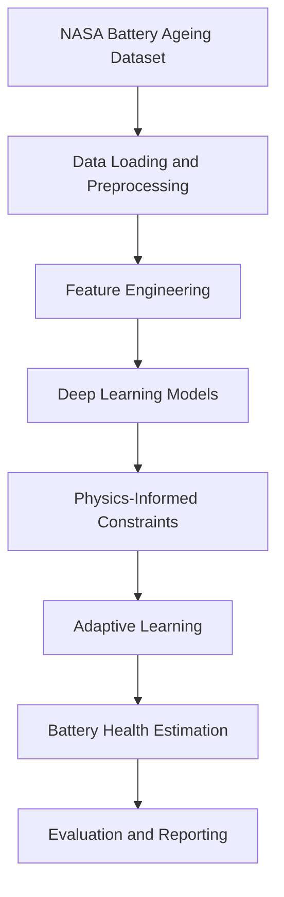

# Adaptive Physics-Informed Battery Digital Twin

**An adaptive machine-learning framework for lithium-ion battery health estimation, physics-informed modelling, and degradation monitoring.**

<p align="center">
  <strong>Python · PyTorch · Deep Learning · Physics-Informed ML · Battery Analytics</strong>
</p>

---

## Overview

Lithium-ion batteries are widely used in electric vehicles, energy storage systems, and portable electronics. Their performance gradually degrades with usage, making accurate battery health estimation and reliable degradation monitoring important for safe and efficient operation.

The **Adaptive Physics-Informed Battery Digital Twin** is a machine-learning-based framework designed to estimate battery health and model degradation behaviour using experimental battery ageing data.

The project combines data-driven deep learning models with physics-informed constraints and adaptive learning mechanisms. Its goal is to improve the reliability and adaptability of battery health estimation under changing operating conditions.

The framework uses the NASA Ames Prognostics Center of Excellence (PCoE) lithium-ion battery ageing dataset.

## Key Features

- **Battery data processing:** Processes battery ageing data and extracts relevant features for modelling.
- **Deep learning models:** Implements DNN, GRU, and Transformer-based approaches for battery health estimation.
- **Physics-informed learning:** Incorporates physics-based constraints into the learning objective through additional penalty terms.
- **Adaptive learning:** Includes drift detection, bounded replay, and online adaptation mechanisms.
- **Model evaluation:** Provides evaluation metrics, robustness analysis, and experiment reporting.
- **Reproducible experiments:** Includes scripts for running experiments, tuning configurations, and generating evidence.

## System Architecture

The project follows a modular pipeline that connects battery data processing, feature engineering, model training, physics-informed learning, and evaluation.



## Technical Approach

### 1. Data Processing and Feature Engineering

The framework processes battery ageing data and prepares relevant input features for model training and evaluation.

The data pipeline is designed to support consistent preprocessing and experimentation across battery cells.

### 2. Deep Learning Models

The project includes multiple model architectures for learning battery degradation patterns:

| Model | Purpose |
|---|---|
| DNN | Learns nonlinear relationships from extracted features |
| GRU | Captures sequential degradation patterns |
| Transformer | Models relationships across input sequences |
| Physics-Informed Model | Incorporates physics-related constraints into model learning |

### 3. Physics-Informed Learning

A key part of the framework is the integration of physics-informed constraints into the learning process.

Instead of relying only on prediction error, the training objective incorporates additional penalty terms representing selected physical consistency requirements.

This encourages predictions to remain consistent with the constraints encoded in the model.

**Note:** This is a physics-informed machine-learning approach, not a complete electrochemical battery simulation.

### 4. Adaptive Learning

Battery degradation behaviour can vary across cells and operating conditions. To address changing data patterns, the project includes adaptive learning components such as:

- Drift detection.
- Bounded replay mechanisms.
- Online model adaptation.

These mechanisms are intended to support model updates as new observations become available.

## Dataset

This project uses the **NASA Ames PCoE Lithium-Ion Battery Ageing Dataset**.

The experiments use the following battery cells:

- B0005
- B0006
- B0007
- B0018

**Dataset source:**

Saha, B., & Goebel, K. (2007). *Battery data set (NASA Ames Prognostics Data Repository) [Data set]. NASA Ames Research Center.*

Source: https://ti.arc.nasa.gov/tech/dash/groups/pcoe/prognostic-data-repository/

The raw dataset files are not included in this repository. Use the provided download script and follow the instructions below to obtain the data.

## Technology Stack

| Category | Technologies |
|---|---|
| Programming Language | Python 3.10+ |
| Deep Learning | PyTorch |
| Data Processing | NumPy, Pandas, SciPy |
| Machine Learning | Scikit-learn |
| Visualization | Matplotlib |
| Testing | Pytest |
| Development | Git, GitHub |

## Repository Structure

```text
Adaptive-Battery-Digital-Twin/
│
├── battery_twin/
│   ├── src/
│   │   └── battery_twin/
│   │       ├── config.py
│   │       ├── data.py
│   │       ├── features.py
│   │       ├── metrics.py
│   │       ├── models.py
│   │       ├── physics.py
│   │       ├── reporting.py
│   │       ├── robustness.py
│   │       └── training.py
│   │
│   ├── scripts/
│   │   ├── download_nasa.py
│   │   ├── render_final_evidence.py
│   │   ├── run_evidence.py
│   │   ├── run_poc.py
│   │   └── tune.py
│   │
│   ├── tests/
│   │   └── test_pipeline.py
│   │
│   ├── data/
│   │   └── raw/
│   │       └── README.md
│   │
│   └── pyproject.toml
│
├── notebooks/
│   └── legacy_exploration_executed.ipynb
│
├── docs/
│   └── architecture_and_analysis.html
│
├── presentations/
│   └── dl_phase2_complete_v3.pptx
│
├── .gitignore
├── PUBLISHING_CHECKLIST.md
└── README.md
```

## Installation and Setup

### Prerequisites

- Python 3.10 or later
- Git
- pip

### 1. Clone the repository

```bash
git clone https://github.com/Shanmukha-Santhosh-03/Adaptive-Battery-Digital-Twin.git
cd Adaptive-Battery-Digital-Twin
```

### 2. Install the project

```bash
python -m pip install -e ./battery_twin
```

For development and testing dependencies:

```bash
python -m pip install -e "./battery_twin[dev]"
```

### 3. Download the NASA dataset

```bash
cd battery_twin
python scripts/download_nasa.py --extract
```

Follow the script instructions if the dataset needs to be downloaded manually.

### 4. Run a synthetic smoke test

```bash
python scripts/run_poc.py --smoke-test --output-dir outputs/smoke
```

This checks the pipeline using synthetic data. It does not demonstrate performance on the NASA dataset.

## Running Experiments

After obtaining and preparing the NASA dataset, run the following commands from the `battery_twin/` directory.

### Run the NASA proof-of-concept experiment

```bash
python scripts/run_poc.py --data-dir data/raw --output-dir outputs/nasa_poc --epochs 40
```

### Run model tuning

```bash
python scripts/tune.py --data-dir data/raw --output outputs/tuning/grid.json --epochs 40
```

### Generate experimental evidence

```bash
python scripts/run_evidence.py --data-dir data/raw --grid outputs/tuning/grid.json --output-dir outputs/final_evidence --epochs 4 --seeds 7 17 27
```

### Run tests

```bash
python -m pytest -q
```

The packaged test suite passed all six tests during project preparation. Run the command above to verify the current checkout and environment.

## Engineering Considerations

The project explores several important challenges in battery health modelling:

- Learning degradation patterns from experimental battery data.
- Combining data-driven predictions with physical consistency constraints.
- Handling changes in data distributions through adaptive mechanisms.
- Comparing different neural network architectures.
- Evaluating model behaviour across multiple battery cells.

The implementation is structured into separate modules to make experimentation, testing, and future improvements easier.

## Current Project Status

The repository contains the core implementation, experiment scripts, tests, documentation, and project presentation.

The framework is an experimental research and engineering prototype. Its results should be interpreted in the context of the selected NASA dataset, experimental setup, and evaluation procedure.

## Future Improvements

Potential directions for further development include:

- Validation across additional battery datasets.
- More extensive cross-cell generalization experiments.
- Improved online adaptation strategies.
- Integration with real-time battery monitoring systems.
- Deployment-oriented optimization and visualization.
- Further investigation of physics-based constraints and battery degradation mechanisms.

## Documentation and Presentation

Additional project material is available in:

- `docs/architecture_and_analysis.html` — architecture and technical analysis.
- `presentations/dl_phase2_complete_v3.pptx` — project presentation.
- `notebooks/legacy_exploration_executed.ipynb` — exploratory notebook.

## Acknowledgements

We acknowledge NASA Ames Research Center and the Prognostics Center of Excellence for making the lithium-ion battery ageing dataset available for research and experimentation.

## Author

**Shanmukha Santhosh**

GitHub: [@Shanmukha-Santhosh-03](https://github.com/Shanmukha-Santhosh-03)

---

*Developed as an engineering project exploring the intersection of battery systems, deep learning, physics-informed machine learning, and adaptive modelling.*
